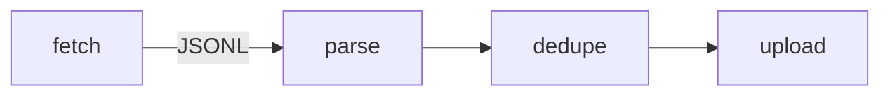

# Unix design

Output: `.dev-docs/features/<slug>/arch.md`, following
`${CLAUDE_SKILL_DIR}/../workflow/references/artifacts.md`. Read `product.md` and
`design.md` first if they exist. Read the existing code before proposing new parts.
Per-rule checks: `${CLAUDE_SKILL_DIR}/references/unix-rules.md`.

## Procedure

0. **Stay inside the map.** If `.dev-docs/system.md` exists, design only inside the
   sub-projects this feature touches. A new cross-project interface goes to `decompose`,
   never into arch.md.
1. **List the jobs.** One component per job, named by the job (`fetch`, `parse`, `dedupe`,
   not `manager`, `service`, `utils`). If you need "and" to describe it, split it.
2. **Pick interfaces before code.** Prefer text: CLI args, stdin/stdout lines, JSON Lines,
   files, exit codes. Use a network API only when the boundary really is a network; then
   write the OpenAPI or JSON Schema file in `contracts/` first and implement against it.
   Write the exact format (fields, one example line, exit codes) into arch.md.
3. **Separate mechanism from policy.** The engine does how; config/data tables say what
   (limits, rules, routes, thresholds). Policy changes must not touch engine code.
4. **Prefer data over code.** Table-driven dispatch instead of if/else chains; rules as data
   rows the engine interprets.
5. **Reuse first.** New code last; every new dependency gets a one-line justification.
6. **One command each.** Each component builds, runs and tests alone with one command
   (`make test-parse`, `./parse < sample.jsonl`). Put that command in the `Run` column of
   every Components row, including in a chat-only answer; a row without one is unfinished.
7. **Silence and loud failure.** No output on success; on failure a specific message on
   stderr naming the input and cause, and a non-zero exit. Never swallow errors.
8. **Contradiction scan.** When a trade-off appears, write it as "need X and not-X"
   (e.g. "need fresh data and not slow requests"). Try to separate it in time (cache now,
   refresh later), space (different component holds each side) or condition (X only when
   Y) before accepting a compromise. Record the result under Decisions.
9. **STRIDE.** One line per row: Spoofing, Tampering, Repudiation, Information
   disclosure, Denial of service, Elevation of privilege — threat at which boundary and
   the mitigation, or `n/a — reason`.
10. **Write arch.md** with `Status: draft`, then ask the user to approve.

Composition patterns between programs and the general rules (adapters, message passing,
pipelines over orchestrators, contract first): `${CLAUDE_SKILL_DIR}/../decompose/references/patterns.md`.

## arch.md sections

~~~markdown
# <Feature> architecture
Status: draft

## Components
| Name | One job | Input | Output | Run |
|---|---|---|---|---|

## Interfaces
<exact CLI usage / line format / JSON Schema / exit codes, with one example each>

## Data flow

## Mechanism vs policy
<engine parts vs config/data tables, where each policy lives>

## Threats
| STRIDE | Threat | Mitigation |
|---|---|---|

## Decisions
<one paragraph each: decision, alternatives, why, contradictions resolved>
~~~
